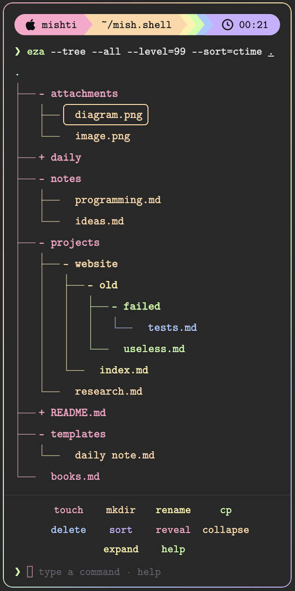
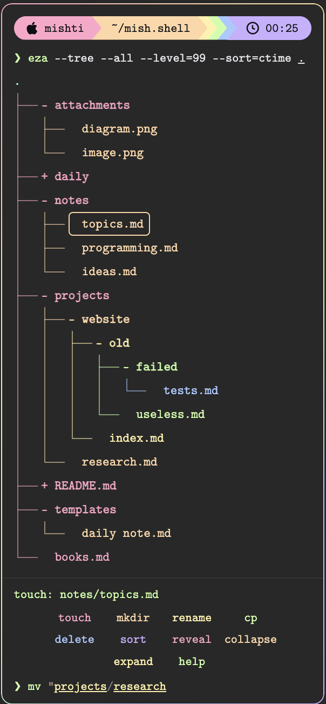

<div align="center">

# mish.eza

**your obsidian file explorer, as `eza --tree` under a starship prompt.**


[what you get](#what-you-get) · [commands](#commands) · [in use](#in-use) · [install](#install) · [settings](#settings) · [privacy](#what-it-runs-on-your-computer) · [fonts](#fonts) · [faq](#faq)

<p align="center">
  
</p>

</div>

a starship-style prompt, a real `eza --tree` listing coloured by depth, and a tiny command line (`touch`, `mkdir`, `rename`, `mv`, `cp`, `rm` and friends) in place of the explorer's buttons.

| prompt | tree | shell |
| --- | --- | --- |
| pills for your user, the vault, the git branch and the time | real `├──` `└──` `│` lines, one colour per depth | `touch` `mkdir` `mv` `cp` `rm` and more, with tab completion |

## what you get

- **a prompt**: pills for your user name (with a logo for your operating system), the vault, the git branch (when the vault is a git repository) and the time.
- **a real tree**: `├──`, `└──` and `│` lines, one colour per depth. click a folder to fold or unfold it, click a note to open it (cmd/ctrl-click for a new tab). right-click a row for obsidian's usual file menu.
- **a little shell** under the tree. type a command, or click its name. tab completes names, up and down bring back earlier lines, and what you type is coloured as you type it. `help` opens a full guide.
- **nothing to install but the plugin**: the font and the icons are bundled.

desktop only.

## commands

| command | what it does |
| --- | --- |
| `touch <name>` | make a note (`.md` is added; `folder/name` puts it in a folder) |
| `mkdir <name>` | make a folder |
| `rename "<new name>"` | rename the note you have open |
| `rename "<folder>/<old>" "<new name>"` | rename a file in a folder |
| `mv "<from>" "<to>"` | move a file or folder |
| `cp [<from>] [<to>]` | copy a file (no names = the open note) |
| `rm <name>` / `delete <name>` | send to the system trash (`rm -r` for a folder with things in it) |
| `sort [name\|mtime\|ctime\|size\|ext]` | change the order of the tree |
| `reveal` · `collapse` · `expand` | jump to the open note · fold all · unfold all |

names with spaces need "quotes". the original explorer is only hidden: run **toggle native file explorer** from the command palette to bring it back, and **redraw the prompt** if the panel ever goes missing.

> **careful:** `rm` and `delete` send things to the system trash and do **not** ask first. you can fish them back out, but mind your fingers.

## in use

<p align="center">
  
</p>

## install

**with [brat](https://github.com/TfTHacker/obsidian42-brat)** (works today): add the beta plugin `mishtiiikrishnaa/mish.eza`.

**by hand:** download `main.js`, `manifest.json` and `styles.css` from the [latest release](https://github.com/mishtiiikrishnaa/mish.eza/releases/latest) into `<your vault>/.obsidian/plugins/mish-eza/`, reload obsidian, and switch the plugin on.

**from obsidian** (once it is listed): settings → community plugins → browse → search for `mish.eza`.

## settings

everything applies live, with no reload.

- **identity**: your own user name, or leave it empty and it is detected.
- **prompt**: show or hide the user, vault, git and time pills.
- **tree**: folders first, or plain a to z.
- **shell**: show or hide the `eza --tree` line and the row of clickable commands.
- **appearance**: pick the font (see [fonts](#fonts)). the **scan** button asks the browser for the monospace fonts you have installed (it may ask permission).

## what it runs on your computer

**no commands and no network.** the little shell is not a real shell. what you type is read by the plugin and mapped onto obsidian's own file functions. nothing is ever sent to your operating system, no program is started, and nothing is downloaded or uploaded.

<details>
<summary>exactly what it touches</summary>

| what | how | why |
| --- | --- | --- |
| your vault's files and folders | obsidian's vault api | to draw the tree |
| the note you have open | obsidian's workspace api | to highlight it, and for `rename` / `cp` with no names |
| `.git/HEAD` in the vault folder | obsidian's vault api, one small read | the git pill. only when that pill is on; if there is no such file, nothing shows |
| your computer's user name | node's `os` module | the first pill. this is why the plugin is desktop only |
| your installed fonts | `window.queryLocalFonts()`, only when you press **scan** | the font menu. the browser asks permission first. the names stay in memory and are not saved or sent anywhere |
| `data.json` in the plugin folder | obsidian's `saveData` | your settings, which folders are unfolded, and the sort order |

what it changes, and only when you run the command: `touch`, `mkdir`, `rename`, `mv` and `cp` create, rename, move or copy things in your vault (obsidian updates links when something is renamed or moved). `rm` and `delete` send things to the system trash.

</details>

you can check the claim yourself. this finds nothing:

```sh
grep -nE "child_process|fetch\(|XMLHttpRequest|WebSocket|eval\(|new Function|innerHTML" main.js
```

## how it fits into obsidian

obsidian has no api for replacing the file explorer, so the plugin does it the only way available: it adds its own panel to the explorer's view and hides the original with css. that depends on obsidian's internal page structure, which can change in an update. if the panel ever misbehaves after an update, run **toggle native file explorer**, and please [open an issue](https://github.com/mishtiiikrishnaa/mish.eza/issues).

## fonts

the default font and the logos are embedded in `styles.css`, so they work on any machine, with nothing to install.

- **cmu typewriter text**, SIL Open Font License 1.1, as a subset embedded under the name "mish mono".
- six glyphs from **symbols nerd font mono**, embedded as "mish icons" (the three operating system logos come from Font Awesome, CC BY 4.0, and the clock from Octicons, MIT).

the subset covers latin letters, digits and common punctuation. a file name in another script is drawn with your system's monospace font instead. the tree lines themselves are drawn with css, so they never depend on the font. you can also pick obsidian's monospace font, your system monospace, any common monospace font found on your computer, or your own css font list.

## faq

<details>
<summary>can i get the normal file explorer back?</summary>

yes. run **toggle native file explorer** from the command palette. turning the plugin off restores it too.

</details>

<details>
<summary>does it delete my notes?</summary>

only when you type `rm` or `delete` yourself, and then they go to the system trash.

</details>

<details>
<summary>why is it desktop only?</summary>

it reads your user name with node's `os` module, which exists on desktop obsidian only.

</details>

<details>
<summary>can a theme restyle it?</summary>

yes. a theme or snippet can set the `--vf-*` css variables (for example `--vf-pink` and `--vf-mono`); each has a default.

</details>

## licence

the plugin's own code is [MIT](LICENSE), (c) 2026 mishti. the embedded fonts keep their own licences: see [THIRD-PARTY-NOTICES.md](THIRD-PARTY-NOTICES.md) and the [`licenses/`](licenses) folder.

<div align="center">

made by [mishti](https://github.com/mishtiiikrishnaa)

</div>
